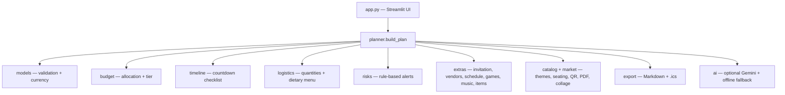

<p align="center">
  
</p>

<h1 align="center">🎉 Celebration &amp; Event Planner</h1>

<p align="center">
  <b>A GenAI-powered planning assistant for weddings, birthdays &amp; community events</b><br>
  Budgets, timelines, vendor checklists &amp; personalised ideas — in one place.
</p>

<p align="center">
  
  
  
  
  
</p>

<p align="center">
  
</p>

> **By Bhavana Shah** · Hack2Skill Virtual: PromptWars — Challenge 5
>
> *The hero image above is an illustration, not a screenshot of the app.*
> See [`FEATURE_COVERAGE.md`](FEATURE_COVERAGE.md) for an honest map of what v3 does,
> what is partial/simulated, and what is a next phase (payments, 3D/AR, real accounts,
> real bookings). Do not claim next-phase features as done.

## ✨ What it does

Turn a few details into a complete, context-aware plan — and a website you can
actually launch: a landing page, a plan builder, guest and vendor managers,
a budget tracker, and exports.

| 🎈 Plan | 👥 Guests | 💰 Budget |
|---|---|---|
| Event name, type, guests, budget, currency, date, city, theme, vibe, dietary &amp; accessibility needs, outdoor or indoor | Real guest list, groups, RSVP, plus-one, dietary notes, QR code, check-in, CSV export | Context-aware split, tier + advice, chart + table, **actual-vs-planned tracker**, expense report (CSV + PDF) |

| 🎮 Fun | 🏪 Vendors &amp; Shopping | 🤖 AI |
|---|---|---|
| Day schedule, games library, quiz &amp; scavenger-hunt builders, lucky draw, music by moment, playlist | Vendor directory, price/status/review manager, contact sheet, shopping catalogue + cart (estimates only) | Rule-based AI assistant + optional Gemini ideas (capped at 5 per session, offline fallback) |

**14 sections:** 🏠 Home · 📋 Plan · 👥 Guests &amp; Invites · 💰 Budget &amp; Expenses ·
🍰 Food &amp; Cake · 🎵 Music &amp; Games · 🧒 Kids · 🎨 Decor &amp; Design ·
🏪 Vendors &amp; Shopping · 🪑 Seating &amp; Floor Plan · 🎤 Live Event Day ·
📸 Post-Event &amp; Memories · 🤖 AI Assistant · ⚙️ Profile &amp; Settings

**Event types:** Birthday, Wedding, Anniversary, Baby Shower, Corporate Party,
Festival / Cultural, Graduation, **Community Event**.
**Currencies:** INR, USD, CAD, GBP, EUR.

## 🚀 Try it

```bash
pip install -r requirements-dev.txt
streamlit run app.py
pytest -q
```

**Live demo:** Streamlit Cloud deployment is in progress for this repo —
the live URL will be added here once deployment is verified. Until then,
run it locally with the commands above.

**Deploy on Streamlit Community Cloud**

1. Push this repo (public, single `main` branch) to GitHub. Keep it under 10 MB.
2. Go to share.streamlit.io → **New app** → pick the repo, branch `main`, file `app.py`.
3. Click **Deploy**. (Optional) Settings → Secrets → `GEMINI_API_KEY=...`

Optional AI ideas: set `GEMINI_API_KEY` (env var or `.streamlit/secrets.toml`,
see `secrets.toml.example`). Without it, offline ideas are used.

## 🧭 How it works



Budget shares are re-normalised so the lines **always sum exactly to the budget**
(last line absorbs rounding). Plans are pure functions of (request, today),
so identical inputs are cached.

This repo merges two builds:
- **The rule-based engine** (from the other `event-planner` project): budget
  tiers, risks, logistics, dietary-safe menu, countdown checklist,
  Markdown + `.ics` export, optional Gemini ideas, CI, and 90 tests.
- **The first Streamlit build**: invitation, vendor checklist, day schedule,
  games, music, item list and personalised ideas.

## ✅ Launch checklist — what “ready to launch” means here

✅ **Ready now:** free, no-account planner, landing page, full plan builder,
guest/vendor/budget tracking, exports, tests, CI, privacy note in-app.

⏳ **Not in v3 (do not claim these yet):** user accounts and login, a database
that persists across devices, email/SMS RSVP sending, vendor booking or
payments, 3D/AR, and a vendor marketplace. Those need a backend, auth, and
payment provider — they are the honest next phase, not hidden in this code.

To launch v3: deploy on Streamlit Cloud, set the app to public, test the
sample plan on a phone, upload a demo video (YouTube Unlisted or Drive),
and link it from your Hack2Skill submission and LinkedIn post.

## 🧪 Tests

```bash
pytest -q
```

**107 tests:** validation, budget invariants, timeline urgency, logistics maths,
menu filtering, risks, prompt-injection fencing, exports, extras (invitation,
games, music, items, currency, Community Event), market helpers (seating,
lucky draw, QR, PDF, collage), and Streamlit AppTest smoke tests.
CI runs them on every push (`.github/workflows/ci.yml`).

## 🛡️ Quality focus areas

- **Code quality:** small single-purpose modules, frozen dataclasses, type hints.
- **Security:** strict allow-list validation, control-character stripping, length caps,
  no `unsafe_allow_html`, API key only from env/secrets (git-ignored), user notes
  fenced as untrusted data in the AI prompt, AI calls capped at 5 per session,
  errors never leak provider details.
- **Efficiency:** pure functions, `st.cache_data` on plans, forms avoid reruns while typing,
  AI only on demand, tiny dependency set.
- **Accessibility:** labelled inputs with help text, high-contrast theme, risk levels
  shown with text + icon (never colour alone), chart data duplicated in a table,
  keyboard-operable native widgets, sensible heading order.
- **Problem alignment:** dynamic decisions from user context, extended with invitation,
  guests, vendors, games, music, items and actual spend tracking.

## 🤖 Gen AI usage

- **Google Gemini** (`google-genai`, model `gemini-2.5-flash`) writes creative
  theme/activity ideas, using the validated plan summary as context.
- The core planning is rule-based; if there is no key or the API fails, the app
  falls back to offline ideas and keeps working.
- Built with AI-assisted coding (Muse), including the merged extras and tests.

## 📝 Assumptions

- Per-guest baselines and cost shares are typical planning heuristics, not quotes.
- Space: 12 sq ft/guest indoor, 15 outdoor; 8 guests per table; 3 guests per vehicle;
  ~4 drinks per guest; 10% food buffer.
- Seasons are India-centric in the original risk rules (rain Jun–Sep, peak wedding
  Nov–Feb); weekend premium is 10–20%.
- Menu is a small illustrative catalogue; always confirm allergens with the caterer.
- Lead times: 30+ days (90+ for weddings).
- Currency conversion is not done — the app splits the number you enter, in the
  currency you choose.

<p align="center">
  <br>
  <b>Made for celebrations — by Bhavana Shah 🎈</b>
</p>
